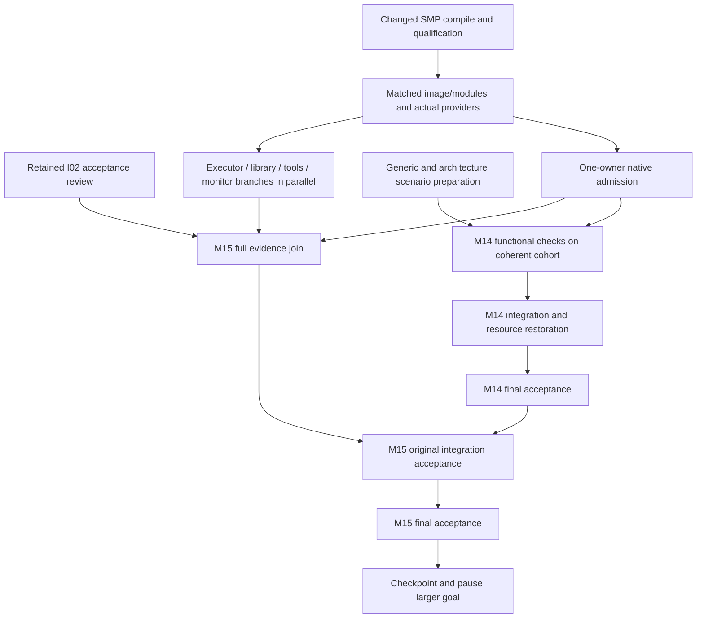

# McKernel: M14 → M15 → complete supported system

## ACTIVE — same Root; qualified modules/image feed actual native admission

Current user resume source0651143a supersedes the historical progress-policy pause.
Invocation20261115T063109Z-9a7c2e96 continues on saved Root
01a18bc3-e072-7810-9426-75101b0856c0. No further resume/restart/control repair is
needed. Functional McKernel OS/apps/Rust/allowed assembly only; NO SECURITY TESTING.
Cadence is advisory; actual user/account/budget/source/service stops remain binding.

User priority: at least90% of agent time goes to engineering and at most10% to
bookkeeping. Execute ready reviewed operations, implement and wire production
repairs, and run necessary affected functional checks before optional reporting
or preparation. Reuse passing objects/images/providers/ABI/installations and
reviews at their proven scope. Reopen a passing review only for a relevant change
or actual failure. No repeated inventories, green reruns, report-only owners or
new control scaffolding. Capture evidence with the operation and batch brief
tracker/checkpoint updates after concrete results. This is a work-allocation
priority, not a measured ratio, new metric project or automatic pause condition.
Keep useful disjoint source/build/test/qualification lanes moving in parallel;
actual aggregate resource, account and ownership checks remain required.

Actual shared build dependency is now PASS and qualified. Whole-SMP1f3372a5/
4e9d2139, finalized IHK e4d348ac and whole guestRust3679adb0 were reused without
recompilation. Matching C4 image34478838 passed in2047ms (artifactQc541282b,
familyQf2599346); the seven unchanged serial module-link/modpost commands passed
in15575ms, producing IHKff9c6239 and SMP08c1f2fc (artifactQ9e500932,
familyQb859774a). All229 imports and24 IHK exports match their actual providers;
CRC zero is not ABI proof. Their new1.25GiB and2GiB families are scoped retired.
Actual modules/image/objects and their recipes are preserved in the existing
persistent cache and docs/verification/m14-m15-build-reuse-20261115/ARTIFACTS.json.
No native/original acceptance follows from linkage alone.

Independent F05 changed-library emission also ACTUALLY PASS in2701ms. Reviewed
source02764df3 is adopted; archivecccc53c4 and DSObb29f28b satisfy unchanged strict
same-compile diagnostics,76 public roots and existing provider requirements
(artifactQc4480e8f/familyQ993c0908). Only its new1.5GiB/job1 is scoped retired.
The original seven warning categories remain recorded. Real balanced-success,
zero-node/zero-compensation, device/backend and restoration remain unproved.
No old caller/ABI/provider/SDK build or green test was rerun.

Current finite original target:M14-I03-E1. Actual authenticated43-file HOST stage
Tool75959 returned0 in33659ms, manifestac76c27e/base40fca963/derived58b29b4f.
Original wait, streams and capture/inputFD closure are qualified (Q0f0beb14); Root
retired ONLY the new1.25GiB/job1 stage family. No native authority follows.
Next actual native operation uses the same image344/modulesff9+08c and ordinary
TIMEa98d/collectordc0e. TimeSource owns one concrete adoption correction: the
staged files lie outside existing readonly roots, so add only their exact stage
root as a readonly mount and matching strict/effective-view binding. Root obtains
the real current source/SDK/lease/account/owner/current-free admission through the
existing frontdoor. No old grant, NULL slot, missing path or stale receipt clears
that gate. The frozen c964/a2f/f133 alternate-repeat packet is untouched.

Verified acceptance:112/156,44open; M14=80.19%,M15=76.25%, both OPEN.
OnlyM15-I02-ACCEPT closed this invocation (+1 from111); this interval closed0.
These qualified builds, staging and scoped retirement are dependency increments.
M14 final acceptance precedes M15 final acceptance. After BOTH checkpoint and
pause the larger saved goal; do not mark the whole OS complete.

The current-only failed module/cleanup/finalizer chain is finished. Original
Tool11446 terminal143 and finalizer Root0 have positive canceled physical-scopeQ
f578079b; Root retired only its current2GiB and finalizer64MiB families. The
intermediate own cleanup families have their separate positiveQ/Root receipts.
Original normal-close/EOF/fsync flags remain false where never observed; canceled
physical closure is not rewritten as normal success. Future latewait repair
870ebc02b remains source-only until a necessary future capture successor uses it.
Do not replay any of these completed controls or signals.

Generic and CredSource continue disjoint private XPMEM attachment/range and
outer-descriptor/partition/close/fork wiring for M14-03-03-FUNCTIONAL. Coupled
final-VM anchor arbitration remains incomplete and cfg OFF; image344 stays at its
qualified source scope. M14Arch's separate spin-provider request returned
"aborted before dispatch" and remains held/UNKNOWN; no retry or reassignment.
Perf source findings remain reusable until genuine matched-native consumer and
FD restoration proof. Reuse the passed process-VM26dea regression and22 vDSO
controls; the separate HOST vDSO sample remains unavailable, not native proof.
F02 realGET_CREDV remains parked on genuine matched mcctrl/device/provider input;
no fake ioctl, no-device substitute or repeated lookup.

Retained baselineHOST4697620480B/jobs4 stays unchanged: old14790/32916 total
384MiB/jobs2 plus two failed SMP families2GiB/job1 EACH. The new successful
HOST stage/image/module/F05 families are already retired at ONLY their positive
scope; no new payload family is currently charged beyond that retained baseline.
Native12GiB/source/lease/IPC/scratch21/globalUNKNOWN and excluded rejected worker
01a1c48d/turn01a1ce01 signal-frame collector/equivalents remain preserved. Never
retry denied/proc/2685747/fd/e015, access old held FDs, infer release from absence
or reset accounting. Current native cgroup readable counters/membership are
positively empty at the latest read; that read alone issues no native grant or
historical clearance. The existing same-controller current-account socket is
available, not a replacement controller.

HOST CPUs0,6,7;28GiB TOTAL shared includes18GiB non-HOST reservation and10GiB HOST.
Preserve2GiB machine reserve, fresh paired-clock/MemAvailable/disk floors and ALL
controller/worker/capture/retained charges. Measured operation-specific job/CPU
changes are allowed; selectedmax5 never drops charges or multiplies RAM. Native
CPUs2-5/12GiB remain separately owned/admitted. Root stays sole integrator/native
executor; existing Sol owners work at their explicit current routing. Same finite
7c6 creditrun/ceiling52079.8011050000, dirty work and accepted checks are preserved.

## Closure plan: all44 current original opens, chained to full M14/M15 acceptance

The original launch baseline was111/156. Current112/156 accepted,44open:18M14 and26M15.
M14 is80.19% andM15 is76.25% verified weighted completion; neither milestone is accepted.
The table below is an execution plan, not new acceptance evidence. All original
conditions, weights and the156 denominator stay unchanged.

The retained full-scope `M15-I02-ACCEPT` review is now explicitly accepted. The shared
whole-SMP GO74c72af7 dependency proceeds through its current binding and fresh28GiB
shared-pool admission while independent M14 implementation/affected verification
continues. Missing actual proof stays open and becomes a concrete next action.

Each passing artifact/scenario becomes input to its dependent original checks.
The Root records actual scope, closes every original condition it fully proves,
then immediately feeds the next ready check. Reuse healthy workers and existing
SDK/image/provider/ABI/install/test/review results. Eleven useful source/qualification
lanes are available initially; aggregate HOST job slots include every retained family;
explicit measured selected limits govern any new compiles/checks. Independent
HOST Docker work may overlap within HOST10GiB/shared28GiB; do not serialize it
behind an unrelated native prerequisite or multiply budgets by container count.
One Root integrates and executes the separately owned native cohort.

| Batch | Open original IDs | Owner and reusable inputs | Required next proof / successor |
| --- | --- | --- | --- |
| 1. Generic functional scope (7) | `M14-03-01-FUNCTIONAL`, `M14-03-02-FUNCTIONAL`, `M14-03-03-FUNCTIONAL`, `M14-03-04-FUNCTIONAL`, `M14-03-05-FUNCTIONAL`, `M14-F03-FUNCTIONAL`, `M14-F03-ACCEPT` | Existing generic contract/scenario owners prepare; Root executes/accepts. Reuse accepted source/default/link/provider/ABI proof. | On the admitted coherent cohort prove dispatch/UTI/drain/exactly-once completion; process/ptrace cleanup; MM/NUMA/XPMEM lifetime; signal/futex/robust wait/restart; credentials/limits/SHM/file/perf ownership. Resolve actual participating XPMEM/perf reference contracts. Preserve actual exec/ACK/TID exclusions. Join all five leaf proofs, close aggregate F03, then its original acceptance. |
| 2. Architecture functional scope (7) | `M14-06-01-FUNCTIONAL`, `M14-06-02-FUNCTIONAL`, `M14-06-03-FUNCTIONAL`, `M14-06-04-FUNCTIONAL`, `M14-06-05-FUNCTIONAL`, `M14-F06-FUNCTIONAL`, `M14-F06-ACCEPT` | Existing architecture/scenario owner prepares; Root executes/accepts. Reuse green source/ABI/link evidence. | Matching TLS/arch_prctl/clone/mmap/SHM translation; supported signal/rt_sigreturn/altstack/context restoration; ptrace regsets and directions/order; vDSO/time-page/TSC publication; cross-process memory/move-pages/NUMA reference and callback cleanup. Use eligible matching evidence; the rejected signal-frame collector remains excluded. Join five leaves before aggregate/F06 acceptance. |
| 3. M14 integration (4) | `M14-I03-E1`, `M14-I03-E2`, `M14-I03-E3`, `M14-I03-ACCEPT` | Root/native authority. Reuse accepted M14-I01 image ownership and other unchanged file/integration proof. | E1: actual coherent image/modules, source-view/current-free and one-owner admission. E2: useful applications and required process/MM/thread/signal behavior. E3: native shutdown/error cleanup and CPU/RAM/reference restoration. Share exact matching observations with batches1/2. Accept I03 and M14 only after every original M14 F/I requirement passes; add no new scenario quotas. |
| 4. Executor (3) | `M15-F02-complete-ABI-behavior`, `M15-F02-native`, `M15-F02-ACCEPT` | Existing executor owner; Root supplies device/native execution. Reuse qualified production object/provider, descriptor, loader/interpreter/non-ELF and ABI slices. | Immediate missing success branch: real GET_CREDV through current matched mcctrl module/device/cohort/BUILDID/access and a newly owned FD lifetime. Finish required success/error obligations, then matching application/offload/process/restoration results. Join complete original evidence before F02 acceptance. |
| 5. Installed diagnostics (4) | `M15-F03-deployed`, `M15-F04-deployed`, `M15-F03-ACCEPT`, `M15-F04-ACCEPT` | Existing diagnostic/tool owners; Root handles installed/native dependencies. Reuse Rust mcinspect/eclair links, selected BFD/libdwarf/libelf, ABI/preflight and genuine consumer results. | Bind delivered artifacts/providers to the same admitted image/runtime and qualify only remaining source-derived runtime-consumer obligations. Accept each original file gate when its original children are demonstrated. |
| 6. Library (3) | `M15-F05-original-behavior`, `M15-F05-deployed-native`, `M15-F05-ACCEPT` | Existing public-ABI/library owner; Root executes device/native scope. Reuse public ABI/environment, ownership-error, parser/IKC/query/create/routing/dump results. | Finish supported function/backend behavior, especially key0 balanced full-success/arithmetic, zero-node and zero-compensation evidence under actual permitted scope. The28 error cases do not prove these regions. Bind installed library/dependencies and restoring lifecycle, then F05 acceptance. Actual excluded bodies require their original supported disposition; no replay. |
| 7. Real commands (6) | `M15-F06-device-behavior`, `M15-F06-native`, `M15-F07-device-behavior`, `M15-F07-native`, `M15-F06-ACCEPT`, `M15-F07-ACCEPT` | Existing ihkconfig/ihkosctl/provider owners; Root runs real device/native operations. Reuse coherent tools/library, links/preflights and focused/default/unknown-action/intr results. | SMP GO74c72af7 supplies the shared F06 dependency. Qualify remaining supported real-device command observations and error/restoring lifecycles against actual matched providers. Join complete original evidence and accept both file gates. |
| 8. Installed monitor/service (3) | `M15-F08-installed-service`, `M15-F08-native`, `M15-F08-ACCEPT` | Existing monitor/service owner; Root runs service/device/native work. Reuse help/partial-start/idle-stop/active-worker/monitor/supervisor/no-event results. | Bind installed daemon/service/udev; prove required real IHK event/kmsg/hung-up behavior, startup/stop/error ordering and cleanup/restoration. Reuse the green supervisor unless relevant inputs change; join full evidence before F08 acceptance. |
| 9. M15 cohort integration (7) | `M15-I04-native-admission`, `M15-I04-cohort`, `M15-I04-applications`, `M15-I04-module-MM`, `M15-I04-restoration`, `M15-I04-acceptance`, `M15-I04-ACCEPT` | Root. Reuse module ownership/bindings/ABI/modpost, SDK/provider/build and matching functional evidence. | I02 retained artifact gate accepted at its exact scope. Bind image/three modules/executor/library/tools as one cohort with actual admission, applications, module load/unload/MM and shutdown/error restoration. Share proven scope with earlier batches. Record original I04 integration/final M15 acceptance after M14 acceptance and every original M15 obligation passes. |

Actual remaining critical dependencies are native/source/current-free authority,
real matched mcctrl device/provider evidence, the eligible XPMEM/perf contracts,
required generic/exec dispositions and F05 success regions. Treat missing
implementation contracts as engineering from actual source/headers/callers, not
an externally authored inventory. Never replace real providers with mocks to
claim native acceptance or reassign the excluded rejected task.

When an operation fails, keep its diagnostic, make the smallest bounded repair,
or park only that branch and keep other ready owners moving. Stop dispatch if
no useful work remains; do not spend models on unchanged blocked turns. Every30
minutes report newly accepted exact IDs, accepted/156, remaining count, weighted
M14/M15 totals, current owners, next missing proofs and separately labelled rough
engineering estimate ranges. The3–5 closure target is not a guaranteed rate.

## Current failure and next trigger

The module/image/library payloads passed. The next exact source defect is the
new native stage-root visibility binding owned by TimeSource; Root then uses
fresh real native/source/account/ownership/resource admission for the unchanged
ordinary TIME boot/application/restoration route. Generic/CredSource wire their
independent XPMEM production repair. A local branch refusal does not pause
eligible independent work; no original condition closes from a partial build.

## Retained inputs and real holds

Delivery remains a functional Rocky Linux build with a C Linux6.x kernel,
McKernel project implementation in Rust/allowed assembly, matching tools/apps,
and actual native lifecycle/resource restoration. Checklists do not replace that
functional image. Do not rerun accepted green proof merely to inspect it.

- M14-I01 ownership/acceptance: docs/verification/m14-i01-original-acceptance-20261114/.
  Root GO3aa05996 and existing image/ABI/provider ownership remain reusable at
  their actual scope. M14-I03 still needs coherent native proof.
- Executor: docs/verification/m15-f02-production-continuation-20261114/.
  Preserve qualified production source6171, objectd511b91b, ELF2282fb60,
  SDK46d47ba9, 119/124 typed providers and776-byte/alignment8 descriptor.
  Real interpreter publication Q82281842, main descriptor Q13851aa2 and
  non-ELF guard Q0a7fe377 are passing increments; they do not close all F02.
- Whole-SMP: qualified actual object1f3372a5/depfile4e9d2139 and matching family
  Q/Root retirement are complete. Reuse them in the paired-module batch.
  Paired-IHK finalobjtool e4d348ac and production guestRust3679 are also qualified;
  the remaining proof is actual module/image/provider/native integration.
- F02 actual provider readiness: /home/holden/mckernel-work/m15-f02-load-elf-current-provider-binding-20261114/ROOT-CURRENT-MATCHED-MCCTRL-DEVICE-PROVIDER-READINESS.json.
  The matched provider is NOT_SUPPLIED_d91922cb, not an inferred absent device.
  GET_CREDV is0x30a0290b/32bytes/eight UID-GID ABI integers. The non-ELF literal
  successor7bcd3a60 is retained; successful load_elf remains unproved.
- Known retained HOST charges:268435456bytes/job1 for failed supplier Tool14790,
  original runtime2685744/b72911894;134217728bytes/job1 for C3 Tool32916,
  parent2737331/b74028874, outer2737329/b74028857. Total402653184bytes/jobs2
  remains held before measured controls/owners. No death/absence-based release.
  Do not signal original Tool14790/runtime or remaining C3 roles. Their actual
  previous PermissionError and incomplete own waits/FD closure remain evidence.
- Other native12/current-free/source/lease/IPC/scratch21/globalUNKNOWN holds remain
  separate. Source work is not blanket-forbidden: derive real contracts from
  existing source/headers/callers and keep eligible independent work moving.
  Actual native execution and each new family need their genuine current owner,
  source/permission/account/resource admission; no invented clearing flags.
- Excluded rejected worker01a1c48d-4d96-7cc3-b733-73a97973152f / turn
  01a1ce01-20cf-7e03-9442-f6d521fb8b02 and its signal-frame collector/equivalents
  are not replayed, rephrased or reassigned. Preserve actual account/service stops.
- The original app-server2661998/b72441133 remains parked with original runtime
  custody; the former controller2661996 and watcher2661994 have exited. Their
  launch locks are free. Private operator transition receipts are retained under
  .git/os-autopilot/operator-stops/. No native/payload reservation was released.

Historical narrative is preserved at
instructions/archive/CAMPAIGN-history-through-20261114.md. It is not a startup
reading list. Use the current source and exact existing machine captures when a
specific original proof needs them; preserve every completed increment.
