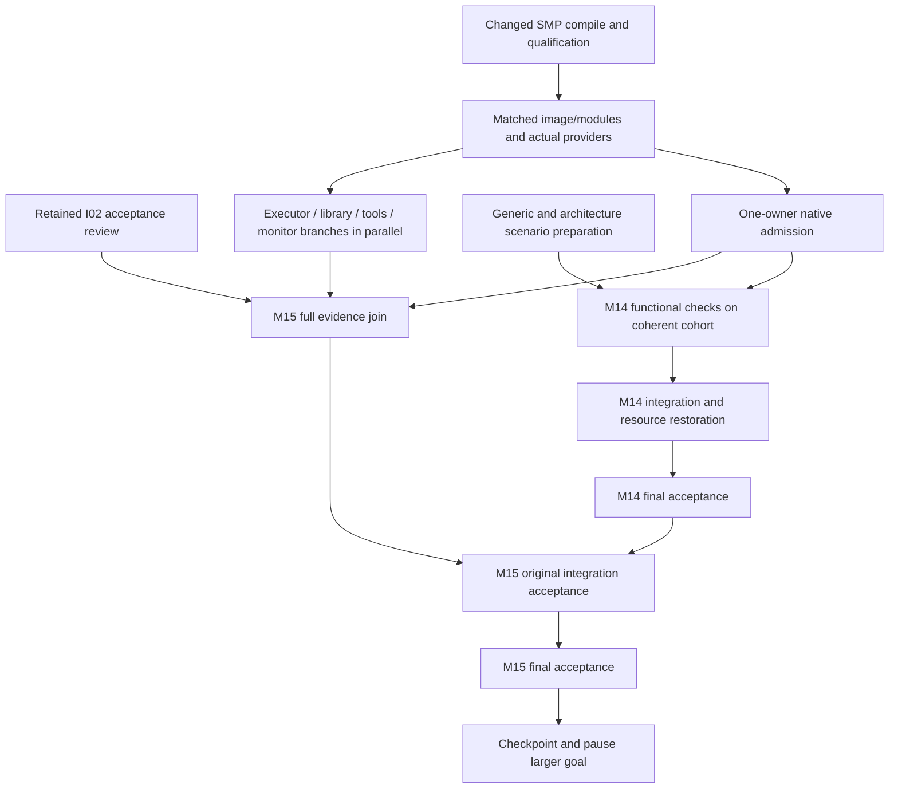

# McKernel: M14 → M15 → complete supported system

## ACTIVE — same Root; module/image linkage is the next operation

Current user resume source0651143a supersedes the historical progress-policy pause.
Invocation20261115T063109Z-9a7c2e96 continues on saved Root
01a18bc3-e072-7810-9426-75101b0856c0. No further resume/restart/control repair is
needed. Functional McKernel OS/apps/Rust/allowed assembly only; NO SECURITY TESTING.
Cadence is advisory; actual user/account/budget/source/service stops remain binding.

Verified acceptance:112/156,44open; M14=80.19%,M15=76.25%, both OPEN.
OnlyM15-I02-ACCEPT closed this invocation (+1 from111); this interval closed0.
Qualified objects and cleanup are dependency increments, not original acceptance.
M14 final acceptance precedes M15 final acceptance. After BOTH checkpoint and
pause the larger saved goal; do not mark the whole OS complete.

Current finite original target:M14-I03-E1. Checked targetb713e43b records the
actual module/image next action. Reuse successful whole-SMP object1f3372a5 and
depfile4e9d2139, Q086f78cf/a432a527/Root e2329ad5; no rebuild.
Paired IHK13-source332852B exact62-token Rust plus18-token objtool ACTUALLY PASS,
raw8754478f/dep1b3e3310 checkpointed before finalobjtool e4d348ac.
ArtifactQ0a248dff/familyQf6db5eaf/Root3ab840d0 retire ONLY its2GiB/job1.
Whole-production guestRust for qualified process-VM repair26deaeb71 ACTUALLY PASS:
object3679adb0/dep e5c963fe, unchanged35-word ABI, Q84b237a3/Rootc74d77bc retire
ONLY its3.5GiB/job1. Original flags retain204 warnings/zero error headers; no claim
of warning-free compilation. Public scoped records are under
 docs/verification/m14-i03-smp-compile-20261115/ and
 docs/verification/m14-process-vm-vectors-20261115/.
Do not repeat SMP/IHK/guestRust/SDK/compiler/ABI or green process-VM cases.

ACTUAL current module failure: created-only own09a7 CID never started; strict
HostConfig comparison refused ONLY Docker omission of output ReadOnly:false.
No linker ran. Exact DATA correction/profile81777913/GO38a23847/argv791bc4d3 is
ready under m14-i03-paired-module-link-20261115/operation-binding-1/current-account-binding-1/current-validator-pin-1/e088-physical-metadata-1/output-mount-serialization-1.
Success-only parent failure path skipped normal removal/input-FD closure and
retained its own context. Failed cleanupTool31543 first inspect exited1/joined
because its ENV omitted established SUDO_ASKPASS; no removal occurred. Current
moduleTool11446 and this failed cleanup remain held, not a global credit stop.
M15CLI prepares only current own controls/CID cleanup; NativeBinding reviews only
its changed effect boundary. Root alone fresh-admits, executes and joins the
original tools; canceled physical FD scope must not be called normal-close.
Preserve all failures. No old supplier/native/denied-scope action is authorized.

Next fresh module parent also folds ONLY user-supplied patch653467d1: prestart
inspect/profile failure normal own-CID cleanup and original FD closure, original
failure preserved; three offline fixtures already PASS. DispatchSource owns its
necessary source/pin successor. This FUTURE helper is not a current held-parent
control. After genuine current-only closure and fresh admission execute the
existing seven serial module-link/modpost commands, preserving inputs/17mounts/
resource guards. No new semantic audit or green rerun.

Independent image link: Generic owns minimal normal Root lifecycle binding for
actor070d418a/GOa1410952 under m14-03-03-affected-production-objects-20261115/current-coherent-image-binding-1/actor-binding-1.
Use qualified3679 plus twelve unchanged inputs, exact13-input recipe/35-word ABI,
SDK46d and matching ld825f11b6. Root alone admits and links once; actual image/map/
provider/import/ABI and family qualification follow. Modules/image then feed
matching native/application/restoration proof; none of these builds closesE1.

Other reusable scope:22 vDSO controls PASS; separate HOST sample is unavailable
(no_at_sysinfo_ehdr/exit2), not native proof. Qec89e38f/49e29e5d and Rootf837/8f9b
already retire only their own512MiB families. Do not rerun controls or sample.
F02 successfulload_elf remains parked on NOT_SUPPLIED matched mcctrl/device inputd919;
no repeated lookup, fake ioctl or no-device substitute. Other disjoint source
work proceeds only for concrete ready original proofs; do not fill idle slots.

Retained baselineHOST4697620480B/jobs4: old14790/32916 total384MiB/jobs2 plus two
failed SMP families2GiB/job1 EACH, unjoined/UNKNOWN. Additional current module
2GiB/job1 and failed cleanup512MiB/job1 stay charged until positive scopedQ/Root
receipt. Every new recovery family also stays charged. Preserve native12GiB,
source/lease/IPC/scratch21/UNKNOWN and excluded rejected worker01a1c48d/turn01a1ce01
signal-frame collector/equivalents. Never retry denied/proc/2685747/fd/e015 or use
privileged alternatives; no absence/death-based release or accounting reset.

HOST CPUs0,6,7;28GiB TOTAL shared includes18GiB non-HOST reservation and10GiB HOST.
Preserve2GiB machine reserve, fresh paired-clock/MemAvailable/disk floors and ALL
controller/worker/capture/retained charges. User permits measured per-operation
job/CPU changes; selectedmax5 is not a waiver to drop charges. A max7 current-own
cleanup projection fits9733386240B/jobs7 with all six retained charges, but is NOT
an execution grant; actual source/account/owner/permission/resource checks precede
any effect. Native CPUs2-5/12GiB remain separately owned/admitted. Eleven is a
coordination ceiling, not multiplied RAM. Root is sole integrator/native executor;
new turns follow current explicit model routing. Same finite7c6 creditrun and
ceiling52079.8011050000, dirty work and every accepted original check are preserved.

## Closure plan: all44 current original opens, chained to full M14/M15 acceptance

The original launch baseline was111/156. Current112/156 accepted,44open:18M14 and26M15.
M14 is80.19% andM15 is76.25% verified weighted completion; neither milestone is accepted.
The table below is an execution plan, not new acceptance evidence. All original
conditions, weights and the156 denominator stay unchanged.

The retained full-scope `M15-I02-ACCEPT` review is now explicitly accepted. The shared
whole-SMP GO74c72af7 dependency proceeds through its current binding and fresh28GiB
shared-pool admission while independent M14 implementation/affected verification
continues. Missing actual proof stays open and becomes a concrete next action.

Each passing artifact/scenario becomes input to its dependent original checks.
The Root records actual scope, closes every original condition it fully proves,
then immediately feeds the next ready check. Reuse healthy workers and existing
SDK/image/provider/ABI/install/test/review results. Eleven useful source/qualification
lanes are available initially; aggregate HOST job slots include every retained family;
explicit measured selected limits govern any new compiles/checks. Independent
HOST Docker work may overlap within HOST10GiB/shared28GiB; do not serialize it
behind an unrelated native prerequisite or multiply budgets by container count.
One Root integrates and executes the separately owned native cohort.

| Batch | Open original IDs | Owner and reusable inputs | Required next proof / successor |
| --- | --- | --- | --- |
| 1. Generic functional scope (7) | `M14-03-01-FUNCTIONAL`, `M14-03-02-FUNCTIONAL`, `M14-03-03-FUNCTIONAL`, `M14-03-04-FUNCTIONAL`, `M14-03-05-FUNCTIONAL`, `M14-F03-FUNCTIONAL`, `M14-F03-ACCEPT` | Existing generic contract/scenario owners prepare; Root executes/accepts. Reuse accepted source/default/link/provider/ABI proof. | On the admitted coherent cohort prove dispatch/UTI/drain/exactly-once completion; process/ptrace cleanup; MM/NUMA/XPMEM lifetime; signal/futex/robust wait/restart; credentials/limits/SHM/file/perf ownership. Resolve actual participating XPMEM/perf reference contracts. Preserve actual exec/ACK/TID exclusions. Join all five leaf proofs, close aggregate F03, then its original acceptance. |
| 2. Architecture functional scope (7) | `M14-06-01-FUNCTIONAL`, `M14-06-02-FUNCTIONAL`, `M14-06-03-FUNCTIONAL`, `M14-06-04-FUNCTIONAL`, `M14-06-05-FUNCTIONAL`, `M14-F06-FUNCTIONAL`, `M14-F06-ACCEPT` | Existing architecture/scenario owner prepares; Root executes/accepts. Reuse green source/ABI/link evidence. | Matching TLS/arch_prctl/clone/mmap/SHM translation; supported signal/rt_sigreturn/altstack/context restoration; ptrace regsets and directions/order; vDSO/time-page/TSC publication; cross-process memory/move-pages/NUMA reference and callback cleanup. Use eligible matching evidence; the rejected signal-frame collector remains excluded. Join five leaves before aggregate/F06 acceptance. |
| 3. M14 integration (4) | `M14-I03-E1`, `M14-I03-E2`, `M14-I03-E3`, `M14-I03-ACCEPT` | Root/native authority. Reuse accepted M14-I01 image ownership and other unchanged file/integration proof. | E1: actual coherent image/modules, source-view/current-free and one-owner admission. E2: useful applications and required process/MM/thread/signal behavior. E3: native shutdown/error cleanup and CPU/RAM/reference restoration. Share exact matching observations with batches1/2. Accept I03 and M14 only after every original M14 F/I requirement passes; add no new scenario quotas. |
| 4. Executor (3) | `M15-F02-complete-ABI-behavior`, `M15-F02-native`, `M15-F02-ACCEPT` | Existing executor owner; Root supplies device/native execution. Reuse qualified production object/provider, descriptor, loader/interpreter/non-ELF and ABI slices. | Immediate missing success branch: real GET_CREDV through current matched mcctrl module/device/cohort/BUILDID/access and a newly owned FD lifetime. Finish required success/error obligations, then matching application/offload/process/restoration results. Join complete original evidence before F02 acceptance. |
| 5. Installed diagnostics (4) | `M15-F03-deployed`, `M15-F04-deployed`, `M15-F03-ACCEPT`, `M15-F04-ACCEPT` | Existing diagnostic/tool owners; Root handles installed/native dependencies. Reuse Rust mcinspect/eclair links, selected BFD/libdwarf/libelf, ABI/preflight and genuine consumer results. | Bind delivered artifacts/providers to the same admitted image/runtime and qualify only remaining source-derived runtime-consumer obligations. Accept each original file gate when its original children are demonstrated. |
| 6. Library (3) | `M15-F05-original-behavior`, `M15-F05-deployed-native`, `M15-F05-ACCEPT` | Existing public-ABI/library owner; Root executes device/native scope. Reuse public ABI/environment, ownership-error, parser/IKC/query/create/routing/dump results. | Finish supported function/backend behavior, especially key0 balanced full-success/arithmetic, zero-node and zero-compensation evidence under actual permitted scope. The28 error cases do not prove these regions. Bind installed library/dependencies and restoring lifecycle, then F05 acceptance. Actual excluded bodies require their original supported disposition; no replay. |
| 7. Real commands (6) | `M15-F06-device-behavior`, `M15-F06-native`, `M15-F07-device-behavior`, `M15-F07-native`, `M15-F06-ACCEPT`, `M15-F07-ACCEPT` | Existing ihkconfig/ihkosctl/provider owners; Root runs real device/native operations. Reuse coherent tools/library, links/preflights and focused/default/unknown-action/intr results. | SMP GO74c72af7 supplies the shared F06 dependency. Qualify remaining supported real-device command observations and error/restoring lifecycles against actual matched providers. Join complete original evidence and accept both file gates. |
| 8. Installed monitor/service (3) | `M15-F08-installed-service`, `M15-F08-native`, `M15-F08-ACCEPT` | Existing monitor/service owner; Root runs service/device/native work. Reuse help/partial-start/idle-stop/active-worker/monitor/supervisor/no-event results. | Bind installed daemon/service/udev; prove required real IHK event/kmsg/hung-up behavior, startup/stop/error ordering and cleanup/restoration. Reuse the green supervisor unless relevant inputs change; join full evidence before F08 acceptance. |
| 9. M15 cohort integration (7) | `M15-I04-native-admission`, `M15-I04-cohort`, `M15-I04-applications`, `M15-I04-module-MM`, `M15-I04-restoration`, `M15-I04-acceptance`, `M15-I04-ACCEPT` | Root. Reuse module ownership/bindings/ABI/modpost, SDK/provider/build and matching functional evidence. | I02 retained artifact gate accepted at its exact scope. Bind image/three modules/executor/library/tools as one cohort with actual admission, applications, module load/unload/MM and shutdown/error restoration. Share proven scope with earlier batches. Record original I04 integration/final M15 acceptance after M14 acceptance and every original M15 obligation passes. |

Actual remaining critical dependencies are native/source/current-free authority,
real matched mcctrl device/provider evidence, the eligible XPMEM/perf contracts,
required generic/exec dispositions and F05 success regions. Treat missing
implementation contracts as engineering from actual source/headers/callers, not
an externally authored inventory. Never replace real providers with mocks to
claim native acceptance or reassign the excluded rejected task.

When an operation fails, keep its diagnostic, make the smallest bounded repair,
or park only that branch and keep other ready owners moving. Stop dispatch if
no useful work remains; do not spend models on unchanged blocked turns. Every30
minutes report newly accepted exact IDs, accepted/156, remaining count, weighted
M14/M15 totals, current owners, next missing proofs and separately labelled rough
engineering estimate ranges. The3–5 closure target is not a guaranteed rate.

## Current failure and next trigger

Current-only module prestart failure and omitted-askpass cleanup are recorded
above and in their immutable raw captures. Root owns the normal recovery and
actual original joins, then one corrected seven-command module batch. Generic's
independent image binding may progress within genuine aggregate headroom.
A local branch refusal does not pause independent eligible work. No original
condition is accepted until all its unchanged literal obligations match.

## Retained inputs and real holds

Delivery remains a functional Rocky Linux build with a C Linux6.x kernel,
McKernel project implementation in Rust/allowed assembly, matching tools/apps,
and actual native lifecycle/resource restoration. Checklists do not replace that
functional image. Do not rerun accepted green proof merely to inspect it.

- M14-I01 ownership/acceptance: docs/verification/m14-i01-original-acceptance-20261114/.
  Root GO3aa05996 and existing image/ABI/provider ownership remain reusable at
  their actual scope. M14-I03 still needs coherent native proof.
- Executor: docs/verification/m15-f02-production-continuation-20261114/.
  Preserve qualified production source6171, objectd511b91b, ELF2282fb60,
  SDK46d47ba9, 119/124 typed providers and776-byte/alignment8 descriptor.
  Real interpreter publication Q82281842, main descriptor Q13851aa2 and
  non-ELF guard Q0a7fe377 are passing increments; they do not close all F02.
- Whole-SMP: qualified actual object1f3372a5/depfile4e9d2139 and matching family
  Q/Root retirement are complete. Reuse them in the paired-module batch.
  Paired-IHK finalobjtool e4d348ac and production guestRust3679 are also qualified;
  the remaining proof is actual module/image/provider/native integration.
- F02 actual provider readiness: /home/holden/mckernel-work/m15-f02-load-elf-current-provider-binding-20261114/ROOT-CURRENT-MATCHED-MCCTRL-DEVICE-PROVIDER-READINESS.json.
  The matched provider is NOT_SUPPLIED_d91922cb, not an inferred absent device.
  GET_CREDV is0x30a0290b/32bytes/eight UID-GID ABI integers. The non-ELF literal
  successor7bcd3a60 is retained; successful load_elf remains unproved.
- Known retained HOST charges:268435456bytes/job1 for failed supplier Tool14790,
  original runtime2685744/b72911894;134217728bytes/job1 for C3 Tool32916,
  parent2737331/b74028874, outer2737329/b74028857. Total402653184bytes/jobs2
  remains held before measured controls/owners. No death/absence-based release.
  Do not signal original Tool14790/runtime or remaining C3 roles. Their actual
  previous PermissionError and incomplete own waits/FD closure remain evidence.
- Other native12/current-free/source/lease/IPC/scratch21/globalUNKNOWN holds remain
  separate. Source work is not blanket-forbidden: derive real contracts from
  existing source/headers/callers and keep eligible independent work moving.
  Actual native execution and each new family need their genuine current owner,
  source/permission/account/resource admission; no invented clearing flags.
- Excluded rejected worker01a1c48d-4d96-7cc3-b733-73a97973152f / turn
  01a1ce01-20cf-7e03-9442-f6d521fb8b02 and its signal-frame collector/equivalents
  are not replayed, rephrased or reassigned. Preserve actual account/service stops.
- The original app-server2661998/b72441133 remains parked with original runtime
  custody; the former controller2661996 and watcher2661994 have exited. Their
  launch locks are free. Private operator transition receipts are retained under
  .git/os-autopilot/operator-stops/. No native/payload reservation was released.

Historical narrative is preserved at
instructions/archive/CAMPAIGN-history-through-20261114.md. It is not a startup
reading list. Use the current source and exact existing machine captures when a
specific original proof needs them; preserve every completed increment.
