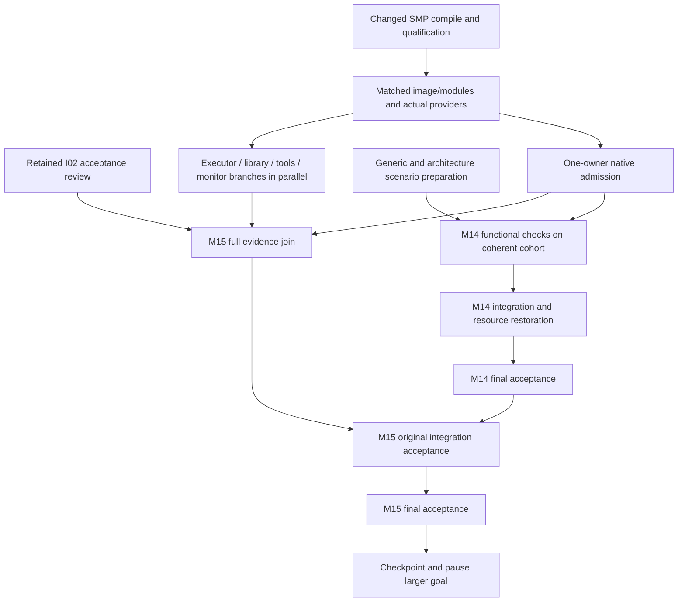

# McKernel: M14 → M15 → complete supported system

## RUNNING — same Root, Sol/MAX, eleven source slots, finite M14 target

Current invocation20261115T063109Z-9a7c2e96 is ACTUALLY running on the same saved
Root. Worker2995304/b81053533 and server2995306/b81053545 completed normal
startup/model catalog/config and exact thread model-effort/permission readback:
GPT-6.1 Sol/MAX,11source slots, depth1, Sol/xhigh children, HOST CPUs0,6,7/jobs5,
28GiB shared total containing18GiB non-HOST plus10GiB HOST. No further restart.
Finite original targetM14-I03-E1 is APPLIED through the checked controller,
receiptfe77de6432f609d5e8ca4cbcfcc07cdacc556f72b1a09ff6b4d716115a1ed81a.
Actual first exact62-token vendor192 whole-SMP compilation RAN and exited1 on
mcd_memory.rs141/142 E0609 (direct vm_start/end absent from Linux6.12 bindings).
Compiler wait/capture/FD closure is qualified FAIL_PARTIAL_HELD fbdf96ef.
The parent/outer Tool10774 and CIDa1fb82a00bd3eb268353653621b621dfffffe9d461a76989b93131cad475ceda
remain in original custody; retain its2147483648B/job1 in addition to original
402653184B/jobs2 and every other hold. No successful object or retirement inferred.
TimeSource's exact two-line anonymous union/struct projection repair is SOURCE GO
e1497db3; corrected leaf12282B/e57dd860,50-file cohort1025696B (other49 unchanged).
DispatchSource owns the fresh isolated operation binding; sameProc reviews only
changed source/count/output/retained-floor joins. Root then freshly admits ONE
changed-source compile using the unchanged62tokens/17mounts/vendor/1.5GiB+512MiB.
No unchanged compiler retry, old-source/output mutation or held-family release.
Public actual diagnostic/qualified partial source record:
docs/verification/m14-i03-smp-compile-20261115/QUALIFIED-COMPILER-FAILURE-AND-BINDING-REPAIR.json.
The next two-case process-VM actual-body regression is separately SOURCE GO728bc899,
with productionRust+C fallback source GO4842b4cc; Root is preparing its exact tools,
fresh output/admission and bounded serial execution (no broad equivalence rerun).
Current rolling30-minute original closure delta is0; invocation delta remains+1
(M15-I02-ACCEPT).112/156/44open,M14=80.19%,M15=76.25%,both OPEN. Concrete
critical action: candidate2 actually failed BEFORE compiler creation at actor325,
because unchanged MANIFEST_SHA256c606 disagreed with exact78607B mountedPACKAGESa842.
Retain its additional2147483648B/job1/Tool42785/CIDf0c62b172b8ab1c2f84ebb3a4a8161046973d180ae89b1bf264a9a38234ecfb4.
Total retained HOST now4697620480B/jobs4 (two failedSMP families plus old384MiB/jobs2).
DispatchSource owns ONLY isolated actor64-char pin+dependent/fresh-output repair;
sameProc review then actual fresh Root admission for one corrected-source compile.
No unchanged failed pin, source, output, grant or old-family replay.
The independent VM regression is ACTUALLY PASS and integrated: both Rust and real
C fallback pass both split-vector cases; six original waits0,21fixtureABI checks,
Q c6ad097c / Root30b20ce4 retire ONLY new2.25GiB/job1. Source postimagesd02c/160e/c080;
public proof docs/verification/m14-process-vm-vectors-20261115/QUALIFIED-RESULTS.json.
Do not rerun these green cases. Next VM proof is affected whole-production Rust
object/current coherent provider/lifetime/native qualification; Generic owns
that source/producer proposal. Corrected vDSO observer SourceGO7058688a is ready
for separately admitted warning-clean ordinary compile/functional controls.
TimeSource derives the actual paired IHK-core(notmcctrl)13-source object/objtool
recipe owning os_runtime.cf1f. No new whole original acceptance or hold release.

NEW ORIGINAL ACCEPTANCE: M15-I02-ACCEPT is explicitly accepted by saved Root on
the full four already-qualified children and exact099/c964+a2f/f133 delivered
three-module artifact cohort. Record:
docs/verification/m15-i02-original-acceptance-20261115/ROOT-ORIGINAL-I02-ACCEPTANCE.json
SHA b07e10ccd422aff1555b24903eda0531b9bc9b09d085408109574e8d526f8c6a.
Current112/156 accepted,44open (18M14/26M15), delta+1 from111 baseline;
M14=80.19%,M15=76.25%, neither milestone accepted. New SMP source, module-load,
applications/native/restoration/current-free and every actual hold remain separate.
Current closure lane remainsM14; this completes the retained I02 review explicitly
requested at startup, and does not dispatch a new M15 runtime lane.

Useful owners: DispatchSource prepares only the current SMP operation binding;
M14Generic authored one-line process-VM remote-index repair plus two actual-body
regressions, under FunctionalDelta independent review; M14Arch implements the
source-defined vDSO observer; CredSource resolves participating perf/reference
lifetime; DebugContract implements the real ordinary HOST admission-provider
adapter. All private/disjoint, no payload/compiler/native effects yet.
The old time/VM whole original functional rows remain OPEN until matching runtime.
A read-only source observation measured MemTotal33199697920/MemAvailable30307774464,
all conservative selected controller/workerRSS1657585664 and old384MiB/jobs2;
this snapshot is not payload admission and will be renewed before execution.

Existing independent observer2985281/b80922657/monitor5337917a6d344274ad79c4ca2f415cb1
has verified identity+lease, current poll06:39:41Z and verified publication06:39:56Z,
SHA4debfd9240fa1a556cc0a29ea759d448f65bb7b8ec7286198f2a8e99db88ea8a.
No second observer or timer was started. Exact PR14 source271e2364 is already an
ancestor of current source9581b04d; loaded controller advertises closure capability1.
Read mailboxc2c63fdd/blob4f14124b and adoption01345300 + dispatch271e2364 in full;
existing receipt/delivery chain is reused. Source/observer/model/target facts do
not imply a qualified ordinary runner operation or unattended engineering acceptance.

The relaunch/operator-stop details below are historical; this manual invocation
supersedes the previous waiting-for-launch banner without releasing any hold.

Latest user direction: integrate the current GitHub harness, make it reliable
without babysitting, use GPT-6.1 Sol/MAX dispatch with Sol/xhigh workers, and let
the dispatcher adjust resources using measured capacity. Keep ready M14 and M15
work moving in parallel; final M14 acceptance still precedes final M15 acceptance.
Use one continuous dependency chain: qualified output becomes input to the next
ready original checks, with no manual restart between increments. The selected
28GiB total shared work pool includes18GiB non-HOST reservations plus10GiB HOST
capacity; it is not28GiB added on top of the native reservation. The host reports
30.9GiB usable, leaving about3GiB outside that budget for the OS.
Repair or park a stuck task. If nothing can proceed, checkpoint and stop dispatch
rather than spin BLOCKED. Target 3–5 original-check closures per rolling30minutes,
reporting actual closed IDs and exact remaining count without guaranteeing a rate.

The user's2026-11-15T06:09Z launch failed before acquiring the saved Root: the old
suspended app-server2661998 still held its writer lock. That server completed its
normal stdio-EOF shutdown and released the lock. The rejected new attempt's
server2985331, worker2985289 and watcher2985266 have also exited. The receipts are
in `.git/os-autopilot/operator-stops/`; no payload/native/UNKNOWN hold or cumulative
credit record was retired or reset. The launcher now checks the exact saved Root
writer before submitting anything. A matching received writer-conflict rejection
also closes only its own unacquired server and exits without an idle keeper/retry.
The20-minute supervision timer is inactive. Do not restart anything automatically:
the user requested the final Python command and will start the next run manually.
The functional reliability suite passed902unique tests with no skips; after the
viewer fix, all7launcher tests passed, including actual ordinary child/tail exit.
Actual
read-only startup verified GPT-6.1 Sol/MAX,11slots,five aggregate HOST jobs,28GiB shared total,
10GiB HOST sub-budget, sleep-inhibition permission and the now-free saved writer.
Engineering has not resumed; the failed attempt started no Root turn or payload.
The old stuck viewer was closed and its original parent reaped the exited child.
The Python launcher now reaps finished children while following the combined log,
so an ended launch exits the viewer normally. Closing that viewer with Ctrl+C
leaves a healthy background run active.

Read instructions/M14-M15-OVERNIGHT.md for the small next-action handoff. Begin with
the ready whole-SMP GO74c72af7 packet serving M15-F06-device-behavior and the coherent
cohort for M14-I03-E1/E2/E3; use the new explicitly selected aggregate resource pool
only after fresh accounting. Reuse every passing compiler/SDK/provider/object and
qualify the actual new result. Keep eligible F02/F05/F08 owner work in parallel.

Verified tracker remains111/156 accepted,45open; M14=80.19%, M15=74.59%, neither
milestone accepted. Engineering estimates do not change these binary statuses.
Keep savedRoot01a18bc3-e072-7810-9426-75101b0856c0, finite cumulative credit
run7c6ef3604bfb4008a917bba8cfb6cfaa and ceiling52079.8011050000. Functional OS/Rust
and allowed assembly only; NO SECURITY TESTING. After both original milestone
acceptances checkpoint and pause the larger goal.

## Closure plan: all44 current original opens, chained to full M14/M15 acceptance

The original launch baseline was111/156. Current112/156 accepted,44open:18M14 and26M15.
M14 is80.19% andM15 is76.25% verified weighted completion; neither milestone is accepted.
The table below is an execution plan, not new acceptance evidence. All original
conditions, weights and the156 denominator stay unchanged.

The retained full-scope `M15-I02-ACCEPT` review is now explicitly accepted. The shared
whole-SMP GO74c72af7 dependency proceeds through its current binding and fresh28GiB
shared-pool admission while independent M14 implementation/affected verification
continues. Missing actual proof stays open and becomes a concrete next action.

Each passing artifact/scenario becomes input to its dependent original checks.
The Root records actual scope, closes every original condition it fully proves,
then immediately feeds the next ready check. Reuse healthy workers and existing
SDK/image/provider/ABI/install/test/review results. Eleven useful source/qualification
lanes are available initially; five aggregate HOST job slots allow the retained
two jobs plus three new compiles/checks when actual accounting permits. Independent
HOST Docker work may overlap within HOST10GiB/shared28GiB; do not serialize it
behind an unrelated native prerequisite or multiply budgets by container count.
One Root integrates and executes the separately owned native cohort.

| Batch | Open original IDs | Owner and reusable inputs | Required next proof / successor |
| --- | --- | --- | --- |
| 1. Generic functional scope (7) | `M14-03-01-FUNCTIONAL`, `M14-03-02-FUNCTIONAL`, `M14-03-03-FUNCTIONAL`, `M14-03-04-FUNCTIONAL`, `M14-03-05-FUNCTIONAL`, `M14-F03-FUNCTIONAL`, `M14-F03-ACCEPT` | Existing generic contract/scenario owners prepare; Root executes/accepts. Reuse accepted source/default/link/provider/ABI proof. | On the admitted coherent cohort prove dispatch/UTI/drain/exactly-once completion; process/ptrace cleanup; MM/NUMA/XPMEM lifetime; signal/futex/robust wait/restart; credentials/limits/SHM/file/perf ownership. Resolve actual participating XPMEM/perf reference contracts. Preserve actual exec/ACK/TID exclusions. Join all five leaf proofs, close aggregate F03, then its original acceptance. |
| 2. Architecture functional scope (7) | `M14-06-01-FUNCTIONAL`, `M14-06-02-FUNCTIONAL`, `M14-06-03-FUNCTIONAL`, `M14-06-04-FUNCTIONAL`, `M14-06-05-FUNCTIONAL`, `M14-F06-FUNCTIONAL`, `M14-F06-ACCEPT` | Existing architecture/scenario owner prepares; Root executes/accepts. Reuse green source/ABI/link evidence. | Matching TLS/arch_prctl/clone/mmap/SHM translation; supported signal/rt_sigreturn/altstack/context restoration; ptrace regsets and directions/order; vDSO/time-page/TSC publication; cross-process memory/move-pages/NUMA reference and callback cleanup. Use eligible matching evidence; the rejected signal-frame collector remains excluded. Join five leaves before aggregate/F06 acceptance. |
| 3. M14 integration (4) | `M14-I03-E1`, `M14-I03-E2`, `M14-I03-E3`, `M14-I03-ACCEPT` | Root/native authority. Reuse accepted M14-I01 image ownership and other unchanged file/integration proof. | E1: actual coherent image/modules, source-view/current-free and one-owner admission. E2: useful applications and required process/MM/thread/signal behavior. E3: native shutdown/error cleanup and CPU/RAM/reference restoration. Share exact matching observations with batches1/2. Accept I03 and M14 only after every original M14 F/I requirement passes; add no new scenario quotas. |
| 4. Executor (3) | `M15-F02-complete-ABI-behavior`, `M15-F02-native`, `M15-F02-ACCEPT` | Existing executor owner; Root supplies device/native execution. Reuse qualified production object/provider, descriptor, loader/interpreter/non-ELF and ABI slices. | Immediate missing success branch: real GET_CREDV through current matched mcctrl module/device/cohort/BUILDID/access and a newly owned FD lifetime. Finish required success/error obligations, then matching application/offload/process/restoration results. Join complete original evidence before F02 acceptance. |
| 5. Installed diagnostics (4) | `M15-F03-deployed`, `M15-F04-deployed`, `M15-F03-ACCEPT`, `M15-F04-ACCEPT` | Existing diagnostic/tool owners; Root handles installed/native dependencies. Reuse Rust mcinspect/eclair links, selected BFD/libdwarf/libelf, ABI/preflight and genuine consumer results. | Bind delivered artifacts/providers to the same admitted image/runtime and qualify only remaining source-derived runtime-consumer obligations. Accept each original file gate when its original children are demonstrated. |
| 6. Library (3) | `M15-F05-original-behavior`, `M15-F05-deployed-native`, `M15-F05-ACCEPT` | Existing public-ABI/library owner; Root executes device/native scope. Reuse public ABI/environment, ownership-error, parser/IKC/query/create/routing/dump results. | Finish supported function/backend behavior, especially key0 balanced full-success/arithmetic, zero-node and zero-compensation evidence under actual permitted scope. The28 error cases do not prove these regions. Bind installed library/dependencies and restoring lifecycle, then F05 acceptance. Actual excluded bodies require their original supported disposition; no replay. |
| 7. Real commands (6) | `M15-F06-device-behavior`, `M15-F06-native`, `M15-F07-device-behavior`, `M15-F07-native`, `M15-F06-ACCEPT`, `M15-F07-ACCEPT` | Existing ihkconfig/ihkosctl/provider owners; Root runs real device/native operations. Reuse coherent tools/library, links/preflights and focused/default/unknown-action/intr results. | SMP GO74c72af7 supplies the shared F06 dependency. Qualify remaining supported real-device command observations and error/restoring lifecycles against actual matched providers. Join complete original evidence and accept both file gates. |
| 8. Installed monitor/service (3) | `M15-F08-installed-service`, `M15-F08-native`, `M15-F08-ACCEPT` | Existing monitor/service owner; Root runs service/device/native work. Reuse help/partial-start/idle-stop/active-worker/monitor/supervisor/no-event results. | Bind installed daemon/service/udev; prove required real IHK event/kmsg/hung-up behavior, startup/stop/error ordering and cleanup/restoration. Reuse the green supervisor unless relevant inputs change; join full evidence before F08 acceptance. |
| 9. M15 cohort integration (7) | `M15-I04-native-admission`, `M15-I04-cohort`, `M15-I04-applications`, `M15-I04-module-MM`, `M15-I04-restoration`, `M15-I04-acceptance`, `M15-I04-ACCEPT` | Root. Reuse module ownership/bindings/ABI/modpost, SDK/provider/build and matching functional evidence. | I02 retained artifact gate accepted at its exact scope. Bind image/three modules/executor/library/tools as one cohort with actual admission, applications, module load/unload/MM and shutdown/error restoration. Share proven scope with earlier batches. Record original I04 integration/final M15 acceptance after M14 acceptance and every original M15 obligation passes. |

Actual remaining critical dependencies are native/source/current-free authority,
real matched mcctrl device/provider evidence, the eligible XPMEM/perf contracts,
required generic/exec dispositions and F05 success regions. Treat missing
implementation contracts as engineering from actual source/headers/callers, not
an externally authored inventory. Never replace real providers with mocks to
claim native acceptance or reassign the excluded rejected task.

When an operation fails, keep its diagnostic, make the smallest bounded repair,
or park only that branch and keep other ready owners moving. Stop dispatch if
no useful work remains; do not spend models on unchanged blocked turns. Every30
minutes report newly accepted exact IDs, accepted/156, remaining count, weighted
M14/M15 totals, current owners, next missing proofs and separately labelled rough
engineering estimate ranges. The3–5 closure target is not a guaranteed rate.

## Last saved execution failure — checkpoint 2026-11-14T22:06:19+00:00

CURRENT EXECUTION BLOCK: corrected whole-SMP Source/operation GO74c72af7 is
COMPLETE (Proc, no findings), original62-token-Dwarnings command/coherent50files/
retained111189482B/17mounts/34+6+identity8 reused. Requested/configured BashAS2GiB
preserved; actualeffectiveinheritanceUNOBSERVED. No SMP compiler/object/depinfo,
Kbuild/module/native operation has run. Same real1.5GiB container+512MiBcontrol=
2GiBfamily/CPU7/job1 remains. Public scoped record:
docs/verification/m15-f06-official-vendor-descriptor-20261114/SMP-SOURCE-GO-RESOURCE-BLOCK.json.
ONE bounded NativeCurrent control-memory proof043c8307 found NO DEFENSIBLE SMALLER
resident slice: capped pipe/capture bytes and total RSS observations do not bound
parent/outer/CLI/interpreter/JSON/source/account heaps and qualified failure-frame
retention. No profile delta, new helper/test, kill/restart, quota reduction or RAM
waiver was issued. Do not rerun this proof/inventory unchanged.
ONE actual fresh Root resource admissiond61cc924 REFUSED: old402653184B/jobs2 +
ALL infrastructure/descendantRSS1906847744B + new2147483648B =4456984576B,
OVER user shared4294967296B by162017280B. Actual account/source phase running and
normal MemAvailable26GiB/host-scratch floors passed; NO payloadgrant/Docker/compiler
was emitted. Scope PARKED awaiting GENUINELY CHANGED aggregate headroom or a
separately justified/independently reviewed control-resident envelope. Supplier is
Root HOST-resource/source owner with matching normal custody/accounting evidence;
not another compiler/SDK/identity check. No unchanged admission/model loops,
guessed smaller quota, native borrowing, held-family release or account override.
Current known HOST payload reservations remain ONLY old402653184B/jobs2 plus ALL
measured controls/owners; native12/source/e01514790/32916/lease/IPC/globalUNKNOWN/
excluded worker01a1c48d-4d96-7cc3-b733-73a97973152f and turn01a1ce01-20cf-7e03-9442-f6d521fb8b02 stay intact.
Other current runtime frontier F02 successful load_elf4LOAD/auxv/realGET_CREDV is
PARKED on ROOT_CURRENT_MATCHED_MCCTRL_DEVICE_PROVIDER_INPUT NOT_SUPPLIED_d91922cb
(source literal successor7bcd3a60). Root/coherent current IHK-mcctrl owner must
supply matching device/module/cohort/BUILDID/access/new-ownFD lifetime via separately
reviewed normal operation; no absent-device inference, repeated lookup/fakeioctl/
no-device case or invented guestCPU/image/CMake quota. No successcaller issued.
Preserve actual qualified main-descriptor Q13851/Root0f0c, nonELF Q0a7fe/Root0ef9,
and vendor192 startup Qe7b84/Root4507. Exact1.92.0/ded5 fullcommit/host/release and
reportedLLVM21.1.6 remain distinct acquired llvm-libs21.1.8/db74; no repeat/codegen/
fulltoolchain/native credit. Their actual own newfamilies are scoped retired;
failed95fea grant/DATA remain immutable after separate no-startQc9/Root98332.
All canonical Source/ABI/provider/SDK/build/lifecycle green evidence stays reused.
Current111/156/45open, M14=80.19%/M15=74.59%/NEITHER accepted. No original ID closed
by source/resource preparation; criteria/weights/156/M14-before-M15 unchanged.
Latest pushed/fetched0ab10af3f preserves nonELF and compiler identity before this
source-GO/resource-block increment. SameRoot/finite7c6/52079.8011050000, no reset/
backup/rejected replay/autorelaunch. Essential custody/controllers/keepers remain;
this is a precise execution block, not OS completion or a user pause.

## Retained inputs and real holds

Delivery remains a functional Rocky Linux build with a C Linux6.x kernel,
McKernel project implementation in Rust/allowed assembly, matching tools/apps,
and actual native lifecycle/resource restoration. Checklists do not replace that
functional image. Do not rerun accepted green proof merely to inspect it.

- M14-I01 ownership/acceptance: docs/verification/m14-i01-original-acceptance-20261114/.
  Root GO3aa05996 and existing image/ABI/provider ownership remain reusable at
  their actual scope. M14-I03 still needs coherent native proof.
- Executor: docs/verification/m15-f02-production-continuation-20261114/.
  Preserve qualified production source6171, objectd511b91b, ELF2282fb60,
  SDK46d47ba9, 119/124 typed providers and776-byte/alignment8 descriptor.
  Real interpreter publication Q82281842, main descriptor Q13851aa2 and
  non-ELF guard Q0a7fe377 are passing increments; they do not close all F02.
- Whole-SMP: /home/holden/mckernel-work/m15-f06-affected-smp-crate-20261114/reviewer-as-metadata-correction-1/.
  Corrected source/operation GO74c72af7, original62-token-Dwarnings command,
  50-file cohort/17mounts and vendor compiler remain ready source inputs.
  Vendor startup Qe7b84e96 proves Rust1.92 identity/startup only, not codegen.
- F02 actual provider readiness: /home/holden/mckernel-work/m15-f02-load-elf-current-provider-binding-20261114/ROOT-CURRENT-MATCHED-MCCTRL-DEVICE-PROVIDER-READINESS.json.
  The matched provider is NOT_SUPPLIED_d91922cb, not an inferred absent device.
  GET_CREDV is0x30a0290b/32bytes/eight UID-GID ABI integers. The non-ELF literal
  successor7bcd3a60 is retained; successful load_elf remains unproved.
- Known retained HOST charges:268435456bytes/job1 for failed supplier Tool14790,
  original runtime2685744/b72911894;134217728bytes/job1 for C3 Tool32916,
  parent2737331/b74028874, outer2737329/b74028857. Total402653184bytes/jobs2
  remains held before measured controls/owners. No death/absence-based release.
  Do not signal original Tool14790/runtime or remaining C3 roles. Their actual
  previous PermissionError and incomplete own waits/FD closure remain evidence.
- Other native12/current-free/source/lease/IPC/scratch21/globalUNKNOWN holds remain
  separate. Source work is not blanket-forbidden: derive real contracts from
  existing source/headers/callers and keep eligible independent work moving.
  Actual native execution and each new family need their genuine current owner,
  source/permission/account/resource admission; no invented clearing flags.
- Excluded rejected worker01a1c48d-4d96-7cc3-b733-73a97973152f / turn
  01a1ce01-20cf-7e03-9442-f6d521fb8b02 and its signal-frame collector/equivalents
  are not replayed, rephrased or reassigned. Preserve actual account/service stops.
- The original app-server2661998/b72441133 remains parked with original runtime
  custody; the former controller2661996 and watcher2661994 have exited. Their
  launch locks are free. Private operator transition receipts are retained under
  .git/os-autopilot/operator-stops/. No native/payload reservation was released.

Historical narrative is preserved at
instructions/archive/CAMPAIGN-history-through-20261114.md. It is not a startup
reading list. Use the current source and exact existing machine captures when a
specific original proof needs them; preserve every completed increment.
